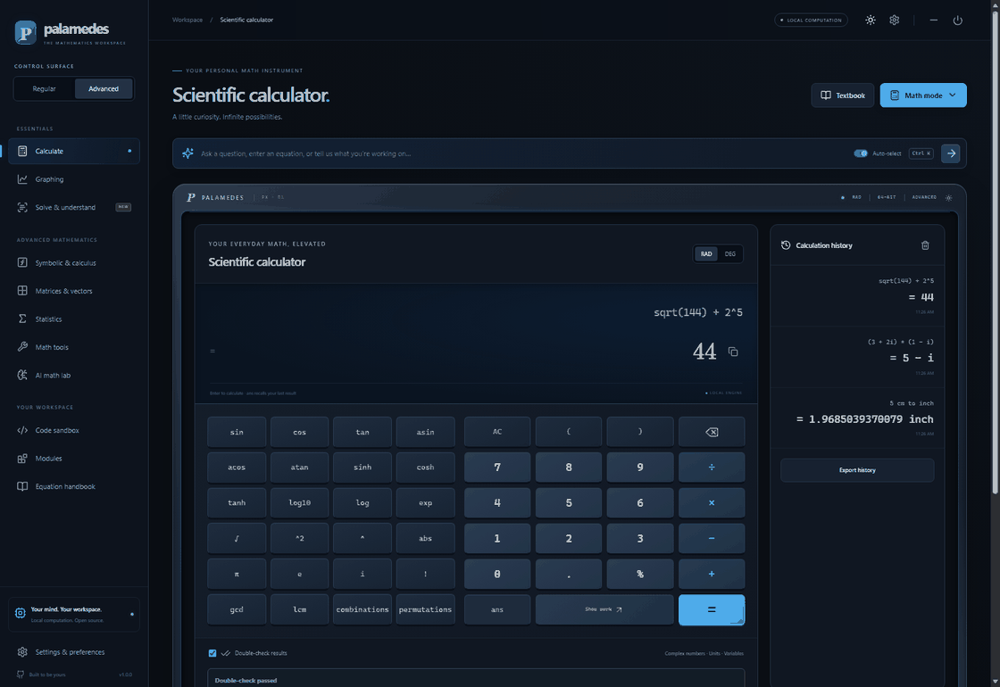
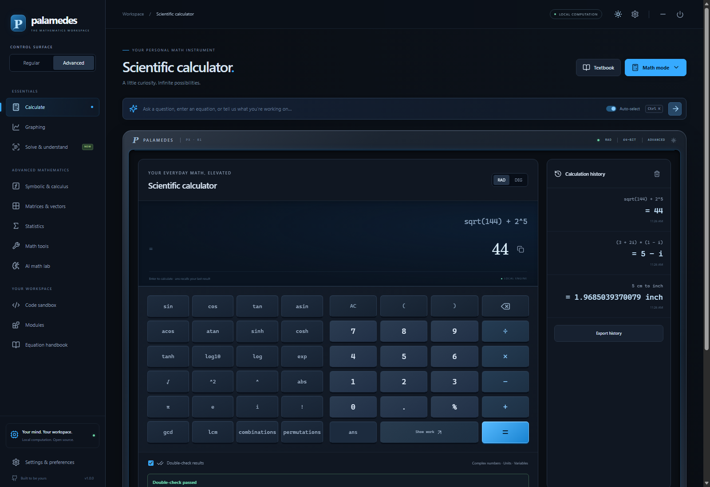
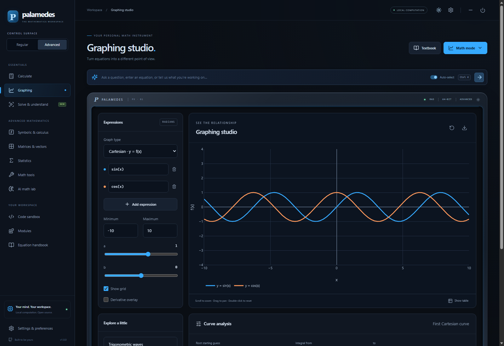
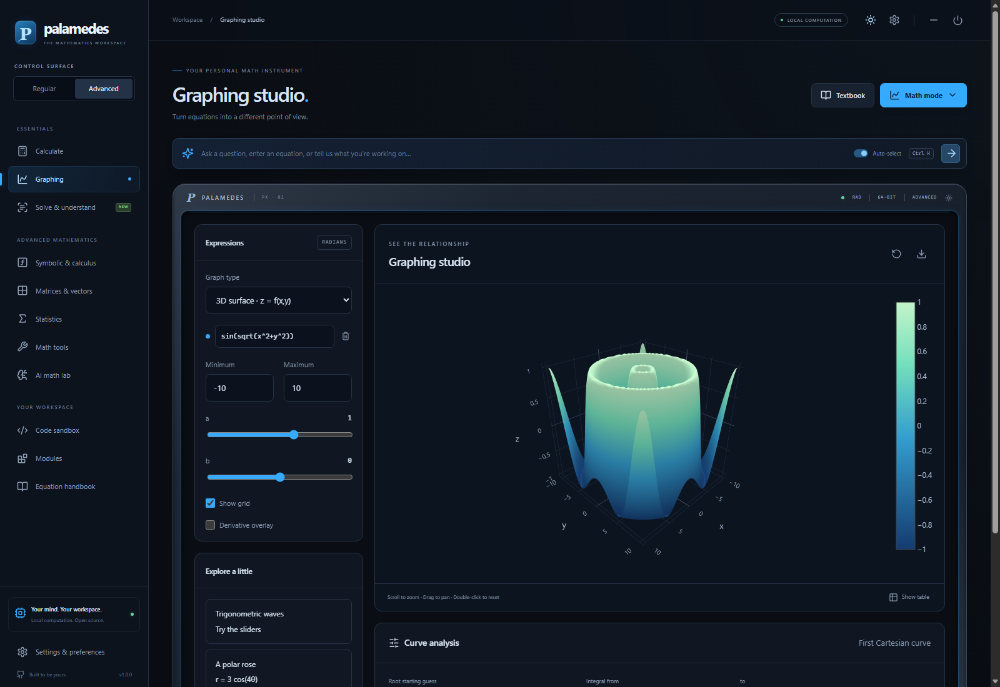
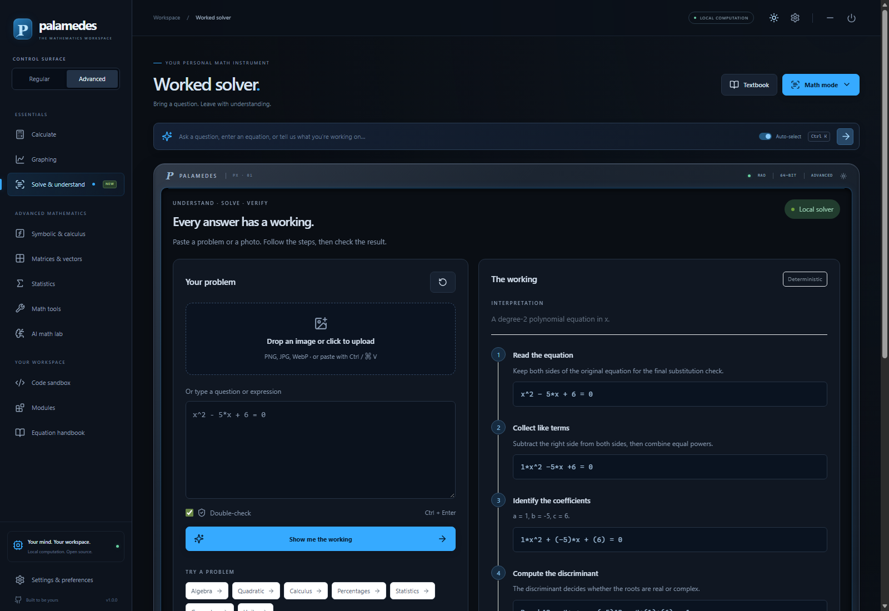
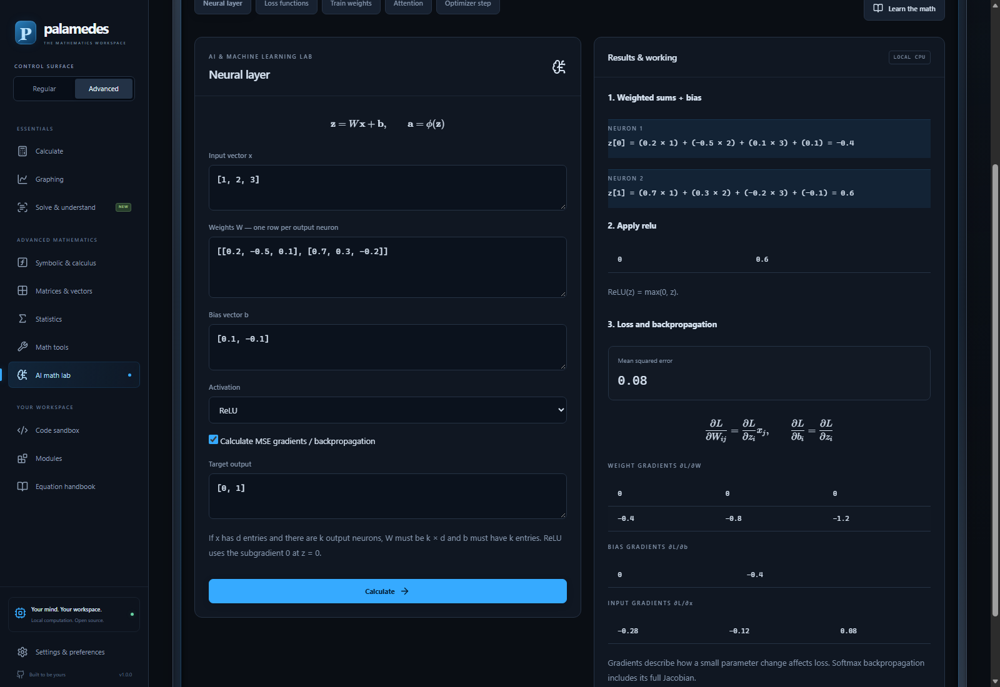
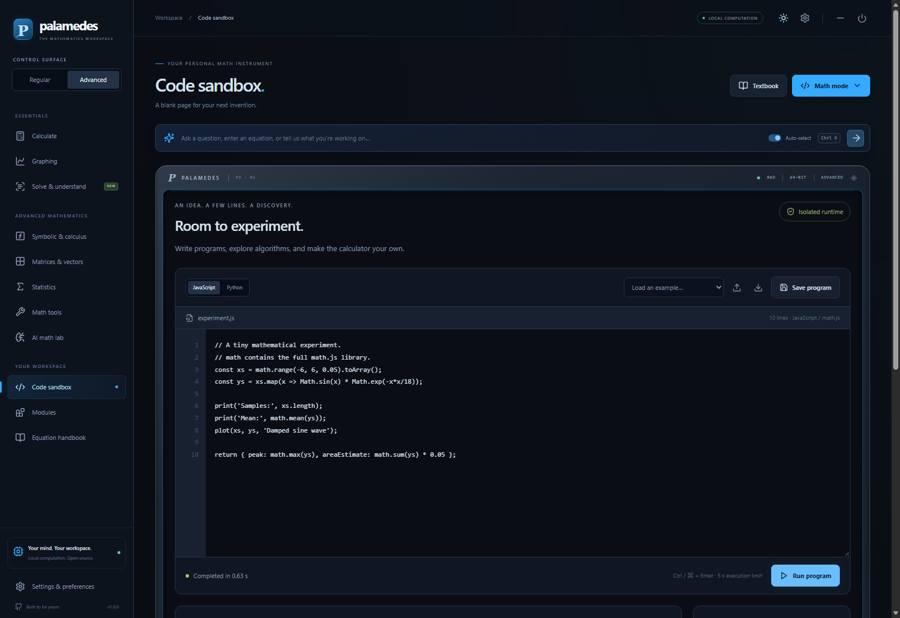
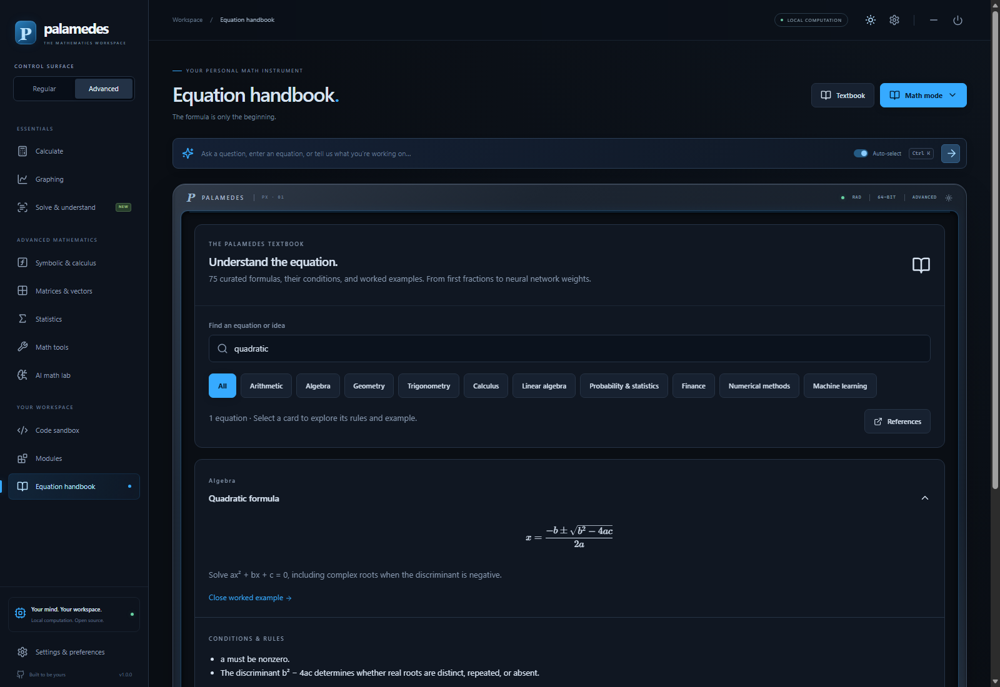

<div align="center">


# Palamedes

### A place for every problem.

[](https://github.com/Ag3nt47/Palamedes/actions/workflows/ci.yml) [](https://github.com/Ag3nt47/Palamedes/actions/workflows/security.yml) [](https://github.com/Ag3nt47/Palamedes/actions/workflows/release.yml)

An open-source mathematics instrument: scientific calculator, graphing studio, symbolic engine, worked solver, AI-math lab, and programmable workspace.

[**Launch the browser app**](https://ag3nt47.github.io/Palamedes/) · [**Desktop downloads**](https://github.com/Ag3nt47/Palamedes/releases) · [User guide](docs/USER_GUIDE.md) · [Capabilities](docs/CAPABILITIES.md)



</div>

Palamedes brings the spirit of premium graphing calculators into a flexible desktop and browser app. Its instrument-style interface takes cues from Angerona and Optimus: dark control surfaces, cyan accents, animated power transitions, a recessed display, and adjustable backlighting. Switch between **Regular** and **Advanced**, scroll through the **Math mode** picker, or let smart input select a workspace.

Core calculations run on your device. No account or AI subscription is required. Optional AI assistance is **off by default**.

## What it does

| Workspace | Capabilities |
|---|---|
| Scientific calculator | Precedence, fractions, powers, roots, logarithms, trig and inverse trig, RAD/DEG, complex numbers, units, combinatorics, variables, custom functions, explicit high-precision numbers, history and export |
| Graphing studio | Multiple Cartesian curves, polar, parametric, implicit contours, interactive 3D surfaces, sliders, derivative overlay, root search, numerical integration, value tables, CSV and PNG export |
| Symbolic & calculus | Simplify, expand, factor, derivatives, antiderivatives, definite integrals, equation solving, limits, Taylor polynomials, finite sums, Laplace and inverse Laplace transforms |
| Worked solver | Supported text patterns, arithmetic operation steps, linear and quadratic equations, real/complex roots, percentage problems, unit conversion, selected geometry/rate/statistics questions, calculus rules and validation |
| Image input | Upload, drag, or paste an image; local OCR; actual progress percentages; editable transcription and confirmation before local solving |
| Linear algebra | Editable matrices, arithmetic, determinant, inverse, transpose, RREF, rank, eigenvalues/vectors, LU, and linear systems with residual checks |
| Statistics | Descriptive statistics, polynomial regression, Student-t confidence intervals and tests, probability densities/masses, CDFs and quantiles |
| Math tools | Units including temperature, finance, numerical root/integral methods, RK4 differential equations, FFT, geometry, exact integer base conversion |
| AI math lab | Dense-layer weights and biases, weighted sums, activations, backprop gradients, losses, gradient-descent training, scaled dot-product attention, causal masking, SGD and Adam |
| Code sandbox | Editable JavaScript and optional Python, run/stop, output, plots, examples, saved programs and imports/exports; worker execution isolated from the host UI |
| Modules | Validated JSON modules containing reusable calculator functions and explicitly run programs; starter engineering and machine-learning packs |
| Equation handbook | **75 curated equations** across ten topics, with descriptions, conditions, unique rules, expandable worked examples, and runnable calculator inputs |
| Optional AI | Session-only keys, OpenAI Responses or compatible Chat APIs, image understanding, structured worked solutions, independent review, and local numerical checks when supported |

The [capability matrix](docs/CAPABILITIES.md) distinguishes the available UI tools from lower-level engine functions. The [calculator benchmark](docs/BENCHMARKS.md) cites official TI, HP, and Casio sources.

## See it in action

<details open><summary><strong>Scientific calculator and premium instrument display</strong></summary>



</details>

<details><summary><strong>Interactive graphing and 3D</strong></summary>




</details>

<details><summary><strong>Worked solutions and checks</strong></summary>



</details>

<details><summary><strong>AI mathematics, code, and textbook</strong></summary>





</details>

## Run locally

Use **Node.js 22.12 or newer**.

```sh
git clone https://github.com/Ag3nt47/Palamedes.git
cd Palamedes
npm ci
npm run dev
```

Open the local address printed by Vite, normally `http://127.0.0.1:5173`.

```sh
npm test              # mathematical, validation, isolation-policy, and syntax checks
npm run build         # production browser bundle
npm run preview       # serve the production bundle
npm run desktop:dev   # build and launch the Electron desktop app
npm run package:win   # Windows x64 installer in release/
npm run package:mac   # macOS universal DMG/ZIP (on macOS)
npm run package:linux # Linux x64 AppImage/DEB (on Linux)
```

Browser interaction tests build and serve an isolated production preview:

```sh
npx playwright install chromium
npm run test:e2e
```

`scripts/capture-demo.mjs` captures the real app screenshots used here. `scripts/make-demo.py` creates the GIF from those captures with Pillow.

## Try these

```text
sqrt(144) + 2^5
sin(30)                          # select DEG
5 cm to inch
(3 + 2i) * (1 - i)
x = 7
f(x) = x^2 + 1
f(5)
fraction(1, 3) + fraction(1, 6)
bignumber("9007199254740993") + bignumber(1)
```

In **smart input**, try `plot sin(x)`, `differentiate x^3`, `[[2,1],[1,3]]`, or `2*x + 3 = 11`. In **Solve & understand**, try `What is 18% of 250?` or paste a clear image of an equation.

Use `^` for powers. Graphs use radians. Numerical routines use floating-point approximations unless stated otherwise.

## Understanding and double-checks

Local comprehension uses explicit mathematical parsing and supported natural-language templates. The app shows its interpretation and rejects wording it cannot map reliably. OCR is general text recognition, not a universal handwriting or mathematical-layout reader. Correct fractions, exponents, signs, and symbols before confirming the transcription.

**Double-check** can perform original-equation substitution, inverse unit conversion, symbolic equivalence checks, finite-difference comparisons, matrix residuals, or high-precision recomputation, depending on the workspace. Checks say **pass**, **fail**, or **inconclusive** and explain what was actually checked. Agreement is evidence, not a formal proof.

For broader input, open **Settings → Optional AI assistance**, explicitly enable it, and enter your provider, model, endpoint, and key. Keys stay in memory until reload or **Disable & clear key**. They are never written into the repository, browser storage, or workspace export. An enabled request sends the submitted problem/image to that endpoint; double-checking adds a separate review request. Compatible services must support the selected structured-output/image API. A localhost proxy can be used. AI integration is tested with mocked requests; no live paid AI request is required or made during the test suite.

## Extend it

Import [the example module](public/modules/example.json) from the Modules workspace:

```json
{
  "schemaVersion": 1,
  "id": "my-math",
  "name": "My math",
  "version": "1.0.0",
  "description": "Reusable functions for my work.",
  "functions": [
    { "name": "cubeCustom", "args": ["x"], "expression": "x^3" }
  ],
  "programs": [
    { "name": "Hello math", "language": "javascript", "code": "print(math.sqrt(144)); return 42;" }
  ]
}
```

Installed functions are available in the calculator. Programs load into the sandbox for review and execute only when **Run** is pressed. JavaScript exposes `math`, `print()`, and `plot(xs, ys, title)`. Every execution starts fresh, is isolated inside an opaque iframe and worker, and is terminated after five seconds. JavaScript network access is blocked. Python downloads a pinned Pyodide runtime from jsDelivr on first use; its sandbox only permits that CDN and does not expose host DOM, storage, or credentials. This is not an unrestricted native package environment.

To add a handbook entry, extend `src/lib/textbook.js` with its formula, conditions, original worked example, and executable check; the textbook tests verify the examples.

## Daily desktop updates

Installed desktop builds check GitHub Releases at most once per 24 hours while open, and persist the last attempted check across restarts. **Check updates** in Settings checks manually. A native dialog asks before any download, installation, or restart. Approval applies only to that offered version; cancellation or failure cancels installation. Download progress is shown in the desktop window title. The update mechanism uses release metadata and installer checksums from `electron-updater`.

To check while the app is closed, an end user may explicitly register the optional per-user Windows task:

```powershell
.\scripts\register-daily-update.ps1 -AppPath "$env:LOCALAPPDATA\Programs\Palamedes\Palamedes.exe"
```

Read the script parameters before use. This repository does not register tasks on installation or run them on your machine automatically. The helper [check-updates.ps1](scripts/check-updates.ps1) launches the installed app’s approval-based updater. Browser tabs use the published web version and cannot install desktop executables.

Tagged `v*` releases build Windows NSIS, macOS universal DMG/ZIP, and Linux AppImage/DEB installers, update metadata, and packaged-app smoke tests through GitHub Actions. Artifacts are published together after every platform succeeds. For a new release, update `package.json` and the lockfile, commit, then push a matching tag. macOS builds are ad-hoc signed, without Apple notarization; Gatekeeper may require explicit approval. Windows builds may trigger SmartScreen. Automatic updates support Windows and Linux AppImage; macOS requires a maintainer’s Developer ID signing/notarization setup, and DEB uses manual/package-manager updates. See [platform details](docs/PLATFORMS.md).

## Scope and accuracy

Palamedes is a broad mathematical workspace, not a claim to solve every possible problem or emulate proprietary calculator firmware. CAS coverage and equation branches are finite. Graph sampling can miss features and singularities. Numerical solvers depend on starting values, conditioning, and convergence. General proofs, unrestricted natural language, exam certification, hardware sensor integration, and proprietary calculator program compatibility are outside its scope. The handbook is curated, not exhaustive.

See [known limitations and implementation details](docs/CAPABILITIES.md), [the user guide](docs/USER_GUIDE.md), and [security notes](SECURITY.md).

## Built with

React · Vite · math.js · Nerdamer · jStat · Plotly · KaTeX · Tesseract.js · Pyodide · Electron · electron-updater. Their licenses remain with their respective projects. Palamedes is [MIT licensed](LICENSE).
